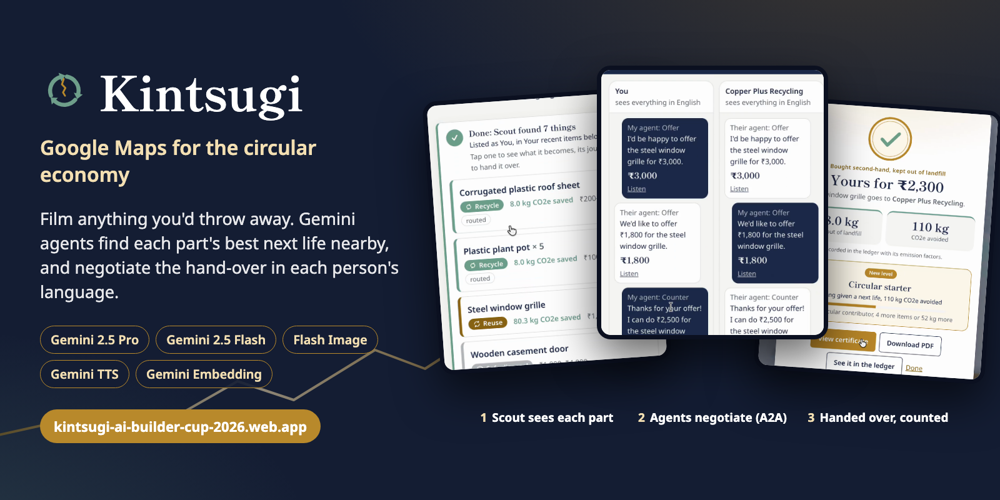

# Kintsugi

**Google Maps for the circular economy.** Point your phone at anything, and AI agents find its best next life.

Kintsugi is a living map of every reusable thing, part and material in a city, run by five Gemini agents. Film a broken chair or a whole building: Scout identifies each item and breaks it into parts and materials, the next-life ladder picks the best destination (reuse, repair, upcycle, harvest parts, recycle, recover energy, safe disposal), market agents negotiate the deal in each person's own language, and the ledger records the kilograms, CO2 and money saved.

Entry for the AI Builder Cup, Sustainability & Social Impact track. The full design is in [docs/implementation.md](docs/implementation.md).

**Try it live: https://kintsugi-ai-builder-cup-2026.web.app** (press **Run demo** for the narrated story)

**Watch the 3-minute demo: https://www.youtube.com/watch?v=DXN9g5Fb7hI**

[](https://www.youtube.com/watch?v=DXN9g5Fb7hI)

## Where things stand

Live on Google Cloud at https://kintsugi-ai-builder-cup-2026.web.app: every Gemini call runs live on Vertex AI, with Firestore, Cloud Storage and Google Maps behind it. 78 backend tests pass, and the app still runs fully offline in **mock mode** (sample data, no Google account needed).

| Part | Status |
|---|---|
| Five agents, the narrated judging demo, Mission control | Live |
| Next-life ladder, hazards, per-part routing, the item's journey | Live, tested |
| People in the loop: confirm or correct items, private lowest price, accept or decline offers, approval before anything is sold | Live, tested |
| Live market: buyers' agents open negotiations by themselves; Start a deal from Handovers | Live, tested |
| Voice in any language, spoken replies (Gemini TTS), English by default | Live |
| Evidence photos with face blur, take-apart steps in the owner's language | Live, tested |
| Seller agent over A2A (agent card + JSON-RPC), buyer agent with a private cap | Live, tested |
| Live ledger, PDF reports, certificates in English, Hindi and Kannada | Live, tested. Emission factors from the UK Government GHG Conversion Factors 2026 (Open Government Licence) |
| Sample cities across Asia-Pacific (Bengaluru, Singapore, Tokyo, Jakarta, Bangkok and more) | Live |
| Web app (installable PWA) and Android app (Capacitor) | Web live; Android builds from the same screens |
| AP2 settlement | Sandbox record shaped like AP2 mandates; no money moves |

**What to do next is in [NEXT_STEPS.md](NEXT_STEPS.md)**, ordered and with "done when" checks. [CLAUDE.md](CLAUDE.md) tells a Claude session how the repo works and which rules keep it working.

## Run it locally (mock mode)

Needs Python 3.11+ and Node 18+.

```bash
# API
cd backend
python -m venv .venv && source .venv/bin/activate
pip install -r requirements-dev.txt
cp .env.example .env            # MOCK_MODE=true by default
uvicorn app.main:app --reload --port 8080

# Web app (second terminal)
cd frontend
npm install
npm run dev                     # http://localhost:5173, /api is proxied to :8080
```

Open the app and press **Run demo** for the narrated story, or film something with **Scan with Scout**. Handovers shows the agents' negotiations, and Ledger shows what was saved.

Tests: `cd backend && pytest -q`

## Android app

The Android app lives in [`android/`](android/README.md). It runs the same screens as the web app inside a native shell with camera, microphone and location permissions, so the team polishes one set of screens. Quick start: `cd frontend && npm install && CAP_SERVER_URL=https://<project>.web.app npm run android:sync && npm run android:open`, then press Run in Android Studio.

Judges will use the web link, which is also installable from Chrome ("Add to Home screen"). The Android app is for filming Scout walkthroughs and showing the deal room on a phone in the demo video.

## Set up your own deployment

1. **Google Cloud:** `PROJECT=<id> REGION=us-central1 ./infra/setup_gcp.sh` enables the APIs, creates Firestore with the vector index, the uploads bucket and IAM roles.
2. **Model IDs:** check the current Gemini model IDs in Vertex AI Model Garden and set `MODEL_*` in `backend/.env`. `gemini-embedding-2-preview` is the multimodal embedding model.
3. **Auth for local runs:** `gcloud auth application-default login`
4. **Smoke test every live call:** `cd backend && MOCK_MODE=false python -m scripts.smoke_live path/to/clip.mp4 path/to/notice.pdf` and fix whatever fails, one call at a time (the code is in `app/llm/gemini.py`).
5. **Switch on:** in `backend/.env` set `MOCK_MODE=false`, `STORE=firestore`, `GCS_BUCKET`, `MAPS_API_KEY`. In `frontend/.env.local` set `VITE_GOOGLE_MAPS_API_KEY` and `VITE_GOOGLE_MAP_ID`.
6. **Measure Scout:** label 30–50 clips in `backend/eval/labels.json` (see `labels.example.json`) and run `python -m eval.run_eval eval/labels.json`. Put the real numbers on a slide.
7. **Replace sample data:** real dealers via the Places API (automatic in live mode), the dealer you interview, your own footage, verified emission factors (`backend/data/emission_factors.json`) and scrap rates (`backend/data/scrap_rates.json`).

## Deploy

```bash
PROJECT=<id> REGION=us-central1 MAPS_API_KEY=<server key> ./infra/deploy_backend.sh   # Cloud Run
PROJECT=<id> ./infra/deploy_frontend.sh                                               # Firebase Hosting
```

Firebase Hosting rewrites `/api/**` to the Cloud Run service, so the app and the API share one origin. Cloud Run runs with one warm instance and CPU always allocated, so judge mode never hits a cold start and background agent jobs keep running. Test the deployed link in an incognito window on a phone before submitting.

## How it works

```
Phone web app ──▶ Cloud Run API (FastAPI) ──▶ agents.py
                                              ├─ Oracle     documents → future supply/demand pins
                                              ├─ Scout      video/photos/voice → item passports
                                              │             (dedup with embeddings, prices, ladder, CO2)
                                              ├─ Architect  Embedding 2 search → design → render
                                              ├─ Market     seller ↔ buyer negotiation, guardrails, settlement
                                              │             + Bundler for neighbourhood pickups
                                              └─ Ledger     per-material CO2 and value, certificates
                         Firestore (+ vector index) · Cloud Storage · Maps Platform · Vertex AI Gemini
```

| File | What it does |
|---|---|
| `backend/app/agents.py` | The five agents and the flows that connect them, including judge mode |
| `backend/app/ladder.py` | Next-life decision rules (the model explains; code decides) |
| `backend/app/negotiation.py` | Concession strategy, guardrails, bilingual turns, sandbox settlement |
| `backend/app/ledger.py`, `materials.py` | CO2 and value accounting with sources; multilingual material aliases |
| `backend/app/bundler.py`, `dedup.py` | Neighbourhood pickup bundles; merging repeat sightings |
| `backend/app/llm/` | `gemini.py` (live), `mock.py` (offline), prompts and JSON schemas |
| `backend/app/store/` | In-memory and Firestore stores behind one interface |
| `backend/kintsugi_adk/agent.py` | The same tools as an ADK coordinator with architect, market and ledger sub-agents |
| `frontend/src/` | React app: `MapView` (Google Maps or schematic), `DealRoom`, `MissionControl`, `Passport` |
| `frontend/capacitor.config.ts`, `android/` | Android app (Capacitor) built from the same screens |

Guardrails worth pointing out to judges: hazards are never routed to reuse; prices can't cross the seller's floor or the buyer's cap (enforced in code and covered by a test with a deliberately rogue proposer); nothing settles without the buyer's tap; private limits never reach the browser; every CO2 figure links to its factor and source.

## Next steps

See [NEXT_STEPS.md](NEXT_STEPS.md).
