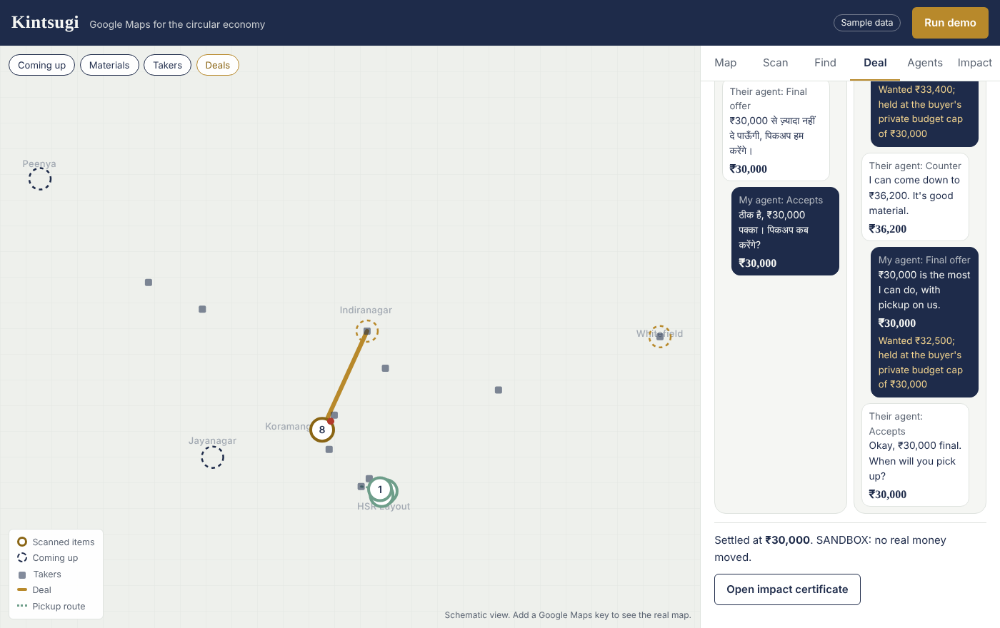

# Kintsugi

**Google Maps for the circular economy.** Point your phone at anything, and AI agents find its best next life.

Kintsugi is a living map of every reusable thing, part and material in a city, run by five Gemini agents. Film a broken chair or a whole building: Scout identifies each item and breaks it into parts and materials, the next-life ladder picks the best destination (reuse, repair, upcycle, harvest parts, recycle, recover energy, safe disposal), market agents negotiate the deal in each person's own language, and the ledger records the kilograms, CO2 and money saved.

Entry for the AI Builder Cup, Sustainability & Social Impact track. The full design is in [docs/implementation.md](docs/implementation.md).



## Where things stand

Everything below runs today in **mock mode** (sample data, no Google Cloud account needed), and 15 automated tests pass. The live Gemini, Firestore, Cloud Storage and Maps code paths are written but **have not been run against the real APIs yet**: that is the first job on Day 1 (see "Going live").

| Part | Status |
|---|---|
| Next-life ladder (rules, per-component routing, hazards) | Done, tested |
| Impact ledger (per-material CO2, value, certificate) | Done, tested. Emission factors are placeholders to verify against ICE |
| Negotiation with hard floor/cap guardrails, bilingual messages | Done, tested |
| Pickup bundling for low-value home items | Done, tested |
| Judge mode (whole story in about a minute) | Done, tested |
| REST API (FastAPI) and job events for Mission control | Done, tested |
| Web app: map, scan, find/design, deal room, agents, impact | Done (schematic map offline; Google Maps with a key) |
| ADK multi-agent app (`adk web`) | Agents build; live conversation untested |
| Gemini calls (Scout video, Oracle docs, pricing with Search grounding, Embedding 2, design, render) | Written, untested live |
| Firestore store with vector search, Cloud Storage uploads, Places/Geocoding | Written, untested live |
| A2A transport between seller and buyer agents | Planned (Thu 15 Oct); agents talk in-process today |
| AP2 settlement | Sandbox record shaped like AP2 mandates; no real AP2 call yet, no money moves |

## Run it locally (mock mode)

Needs Python 3.11+ and Node 18+.

```bash
# API
cd backend
python -m venv .venv && source .venv/bin/activate
pip install -r requirements-dev.txt
cp .env.example .env            # MOCK_MODE=true by default
uvicorn app.main:app --reload --port 8080

# Web app (second terminal)
cd frontend
npm install
npm run dev                     # http://localhost:5173, /api is proxied to :8080
```

Open the app and press **Run demo**. Watch the Agents tab, then look at Deal and Impact.

Tests: `cd backend && pytest -q`

## Going live (Day 1 checklist)

1. **Google Cloud:** `PROJECT=<id> REGION=us-central1 ./infra/setup_gcp.sh` enables the APIs, creates Firestore with the vector index, the uploads bucket and IAM roles.
2. **Model IDs:** check the current Gemini model IDs in Vertex AI Model Garden and set `MODEL_*` in `backend/.env`. `gemini-embedding-2-preview` is the multimodal embedding model.
3. **Auth for local runs:** `gcloud auth application-default login`
4. **Smoke test every live call:** `cd backend && MOCK_MODE=false python -m scripts.smoke_live path/to/clip.mp4 path/to/notice.pdf` and fix whatever fails, one call at a time (the code is in `app/llm/gemini.py`).
5. **Switch on:** in `backend/.env` set `MOCK_MODE=false`, `STORE=firestore`, `GCS_BUCKET`, `MAPS_API_KEY`. In `frontend/.env.local` set `VITE_GOOGLE_MAPS_API_KEY` and `VITE_GOOGLE_MAP_ID`.
6. **Measure Scout:** label 30–50 clips in `backend/eval/labels.json` (see `labels.example.json`) and run `python -m eval.run_eval eval/labels.json`. Put the real numbers on a slide.
7. **Replace sample data:** real dealers via the Places API (automatic in live mode), the dealer you interview, your own footage, verified emission factors (`backend/data/emission_factors.json`) and scrap rates (`backend/data/scrap_rates.json`).

## Deploy

```bash
PROJECT=<id> REGION=us-central1 MAPS_API_KEY=<server key> ./infra/deploy_backend.sh   # Cloud Run
PROJECT=<id> ./infra/deploy_frontend.sh                                               # Firebase Hosting
```

Firebase Hosting rewrites `/api/**` to the Cloud Run service, so the app and the API share one origin. Cloud Run runs with one warm instance and CPU always allocated, so judge mode never hits a cold start and background agent jobs keep running. Test the deployed link in an incognito window on a phone before submitting.

## How it works

```
Phone web app ──▶ Cloud Run API (FastAPI) ──▶ agents.py
                                              ├─ Oracle     documents → future supply/demand pins
                                              ├─ Scout      video/photos/voice → item passports
                                              │             (dedup with embeddings, prices, ladder, CO2)
                                              ├─ Architect  Embedding 2 search → design → render
                                              ├─ Market     seller ↔ buyer negotiation, guardrails, settlement
                                              │             + Bundler for neighbourhood pickups
                                              └─ Ledger     per-material CO2 and value, certificates
                         Firestore (+ vector index) · Cloud Storage · Maps Platform · Vertex AI Gemini
```

| File | What it does |
|---|---|
| `backend/app/agents.py` | The five agents and the flows that connect them, including judge mode |
| `backend/app/ladder.py` | Next-life decision rules (the model explains; code decides) |
| `backend/app/negotiation.py` | Concession strategy, guardrails, bilingual turns, sandbox settlement |
| `backend/app/ledger.py`, `materials.py` | CO2 and value accounting with sources; multilingual material aliases |
| `backend/app/bundler.py`, `dedup.py` | Neighbourhood pickup bundles; merging repeat sightings |
| `backend/app/llm/` | `gemini.py` (live), `mock.py` (offline), prompts and JSON schemas |
| `backend/app/store/` | In-memory and Firestore stores behind one interface |
| `backend/kintsugi_adk/agent.py` | The same tools as an ADK coordinator with architect, market and ledger sub-agents |
| `frontend/src/` | React app: `MapView` (Google Maps or schematic), `DealRoom`, `MissionControl`, `Passport` |

Guardrails worth pointing out to judges: hazards are never routed to reuse; prices can't cross the seller's floor or the buyer's cap (enforced in code and covered by a test with a deliberately rogue proposer); nothing settles without the buyer's tap; private limits never reach the browser; every CO2 figure links to its factor and source.

## Next steps (from the build plan)

- **Mon 12 Oct:** run `smoke_live`, fix Scout on real footage, label the first 15 clips.
- **Tue 13 Oct (checkpoint):** Scout produces usable inventories from your footage. If not, narrow item classes and clip length.
- **Wed 14 Oct:** live Embedding 2 search and Firestore vector index; verify emission factors.
- **Thu 15 Oct:** expose seller and buyer agents over A2A (a2a-sdk), AP2 sandbox or a clearly labelled mock; Gemini Live API voice input.
- **Fri 16 Oct:** deploy, judge mode on real data, run the eval.
- **Sat 17 Oct:** feature freeze at noon, record the video.
- **Sun 18 Oct:** submit early.
